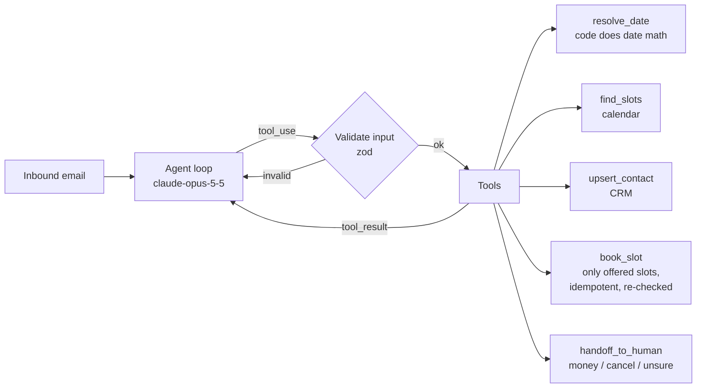

# intake-agent

A tool-calling agent that reads an inbound enquiry, works out what the sender wants, and books a call. Code owns the facts the model tends to get wrong: dates, free time and what was actually booked.

> **Status:** personal project, started Nov 2026. The core loop, guardrails and tests work. The calendar and CRM are in-memory adapters; Google Calendar and Postgres adapters are on the roadmap. This repo is a clean-room rewrite of a pattern I've built for clients, using none of their code.



## Guardrails

The model only decides. These are enforced in code (`src/tools.ts`, `src/agent.ts`):

| Risk | Guard |
|---|---|
| Model invents a date ("next Friday" across time zones) | `resolve_date` turns the phrase into a date in the business time zone. Ambiguous phrases return an error, so the agent asks the customer. |
| Model offers a slot that doesn't exist | `book_slot` only accepts slot ids that `find_slots` returned in this run, and re-checks availability at write time. |
| Retry double-books | Each booking is keyed on the inbound message id. |
| Malformed arguments | Tools use `strict: true` and are validated again with zod. Errors go back as `is_error` tool results. |
| Runaway loop | Fixed budget of tool calls per run. When it runs out, the case goes to a human. |
| Money, cancellations, complaints | The system prompt routes these to `handoff_to_human`. Evals check this. |

## Run

```bash
npm install
npm test                 # unit tests with a scripted fake model (no API key needed)
export ANTHROPIC_API_KEY=...
npm run demo -- "Can we talk tomorrow afternoon about an online store? Tunde, tunde@shop.test"
npm run eval             # golden set against the live model
```

## Evaluation

`evals/golden.json` holds labelled enquiries: new leads with relative dates, a refund, a cancellation, spam, an ambiguous date and a weekend request. `evals/run.ts` scores each case against a fixed clock with deterministic checks:
- intent
- whether a booking was made
- booked date and time window
- correct handoff reason
- the reply states the booked time

Run it before any prompt or model change. Published results are on the roadmap.

## Roadmap

- [ ] Google Calendar and Postgres CRM adapters
- [ ] Gmail draft-reply tool and a Slack handoff
- [ ] Bigger golden set, LLM-as-judge for reply tone, a results table in CI
- [ ] Webhook entry point (n8n / HTTP)

MIT licence.
